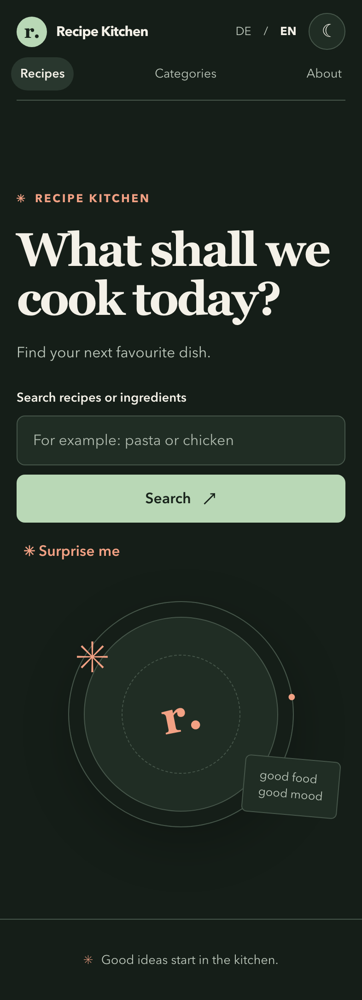

# Recipe Kitchen

[Deutsch](README.md) | **English**

[Live app](https://michkffm.github.io/Rezepte/)

Recipe Kitchen is a browser-based app for searching recipes, browsing categories, discovering random recipes, and viewing recipe details. Its interface is available in German and English, with light and dark themes. Recipe names and instructions remain in the language provided by TheMealDB.



## Features

- Search by recipe name and browse by category
- Discover a random recipe
- View ingredients, instructions, and an optional recipe video
- German and English interface
- Light and dark themes with the selection saved in the browser
- Responsive layout for phones and desktop devices

## Run locally

```bash
git clone https://github.com/michkffm/Rezepte.git
cd Rezepte
npm ci
npm run dev
```

## Check and build

```bash
npm run lint
npm run build
```

## Technologies and data

- React and JavaScript
- Vite
- TheMealDB API for recipe and category data
- GitHub Pages for deployment
