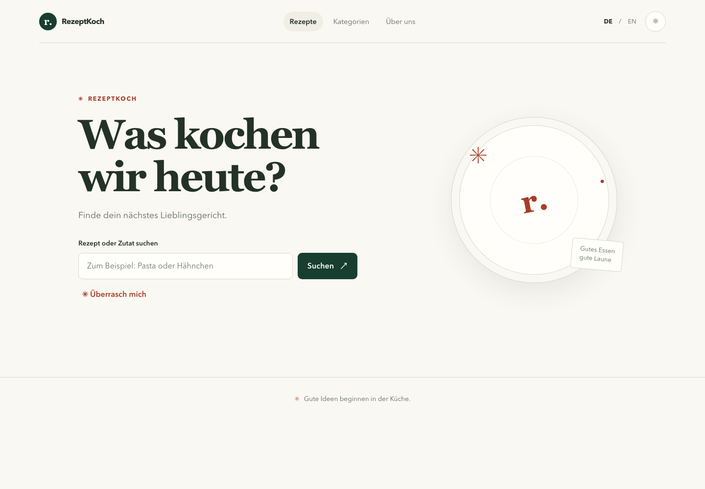

# RezeptKoch

**Deutsch** | [English](README.en.md)

[Live-App](https://michkffm.github.io/Rezepte/)

RezeptKoch ist eine browserbasierte Rezept-App mit Suche, Kategorien, Zufallsrezepten und Rezeptdetails. Die Oberfläche ist auf Deutsch und Englisch verfügbar und bietet Hell- und Dunkelmodus. Rezeptnamen und Anleitungen erscheinen in der Sprache, in der TheMealDB sie bereitstellt.



## Funktionen

- Suche nach Rezeptnamen und Durchsuchen nach Kategorie
- Zufallsrezept entdecken
- Zutaten, Anleitung und optionales Rezeptvideo ansehen
- Deutsche und englische Oberfläche
- Hell- und Dunkelmodus mit im Browser gespeicherter Auswahl
- Responsive Darstellung für Smartphones und Desktopgeräte

## Lokal starten

```bash
git clone https://github.com/michkffm/Rezepte.git
cd Rezepte
npm ci
npm run dev
```

## Prüfen und bauen

```bash
npm run lint
npm run build
```

## Technologien und Daten

- React und JavaScript
- Vite
- TheMealDB API für Rezept- und Kategoriedaten
- GitHub Pages für die Veröffentlichung
